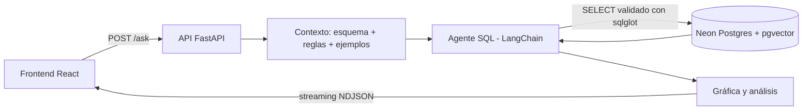
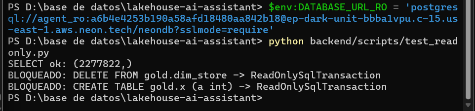

# Asistente de analítica con IA sobre el Lakehouse

Proyecto final de **Bases de Datos II**. Un asistente que responde preguntas de negocio en español: genera el SQL, lo ejecuta con un rol de solo lectura y devuelve la respuesta (más adelante, también tabla, gráfica y análisis).

> **Estado:** entrega 1 (v0.1). Datos cargados en Neon y seguridad por diseño lista. El agente y la API se documentan al terminar la sección 5 de la guía.

## 1. Problema

El Lakehouse del curso (capas bronze, silver y gold en AWS) responde bien a quien sabe SQL, pero un usuario de negocio no. Este proyecto pone un asistente encima de la capa **Gold** para que cualquiera pregunte en lenguaje natural («¿cuáles son las 5 categorías con mayores ventas netas?») y obtenga una respuesta verificable, con el SQL a la vista.

## 2. Arquitectura



Flujo: la pregunta llega a la API, se arma el prompt con el contexto, el agente escribe un `SELECT`, el validador lo revisa, se ejecuta con el rol `agent_ro` y el resultado vuelve a la interfaz.

**Stack:** Neon (Postgres + pgvector), FastAPI, LangChain, Gemini (con Groq y Ollama de respaldo), sqlglot, fastembed, Plotly, React + Vite, Docker Compose.

## 3. Datos y decisión de la muestra del 20 %

La tabla `fact_sales` del Lakehouse tiene más de 10 millones de filas y el plan gratuito de Neon permite 1 GB por proyecto. Se exportó el **20 % de los pedidos completos** (`mod(order_id, 5) = 0`, con todas las líneas de cada pedido elegido), de modo que las cifras siguen siendo coherentes y se conserva todo el rango de fechas.

> **Limitación:** los totales absolutos son aproximadamente **1/5** de los del Lakehouse completo. El asistente lo indica en sus respuestas.

### Datos cargados en Neon (evidencia 1)

| Tabla | Filas |
|---|---|
| `gold.fact_sales` | 2.277.822 |
| `gold.dim_date` | 4.019 |
| `gold.dim_customer` | 296.906 |
| `gold.dim_product` | 5.001 |
| `gold.dim_store` | 151 |
| `gold.dim_geography` | 9 |
| `gold.agg_sales_dept_age_quarter` (mart) | 392 |

- Integridad: 0 filas de `fact_sales` sin producto en `dim_product`.
- Estados de pedido: `cancelled`, `completed`, `pending`, `returned`, `shipped`.
- Fecha de referencia («hoy» para el asistente): **2026-11-11**.
- Tamaño de la base: `TODO` MB (medir después de índices y mart).

El mart se recalcula en Neon desde la muestra para que sus cifras coincidan con la tabla de hechos.

## 4. Seguridad por diseño

Tres capas independientes; si una falla, las otras contienen el daño:

1. **Rol de solo lectura en Neon (`agent_ro`):** `default_transaction_read_only = on`, `statement_timeout = 15s` y límite de conexiones. La aplicación nunca usa el rol dueño.
2. **`include_tables` en LangChain:** el agente solo ve las tablas de Gold.
3. **Validador con `sqlglot`:** acepta una sola sentencia `SELECT`, solo sobre tablas permitidas, y añade `LIMIT`. `TODO` (en construcción).

Prueba del rol (evidencia 2): con `agent_ro`, `SELECT` funciona y `DELETE` y `CREATE TABLE` fallan con `ReadOnlySqlTransaction`.



Los secretos viven en archivos ignorados por Git (`.env` y `.env.owner`). La cadena del rol dueño solo la usan los scripts de carga, nunca la aplicación.

## 5. Estructura del repositorio

```
backend/        API, agente, contexto, scripts y pruebas
frontend/       Interfaz en React + TypeScript
sql/            Esquema, roles y tabla de conocimiento (RAG)
data/export/    Parquet exportado de Athena (no va a Git)
docs/evidence/  Capturas de cada entrega
```

## 6. Cómo correrlo

### Requisitos
Python 3.11 o superior, una base en Neon con la extensión `vector` y claves del LLM (Gemini o Groq).

### Configuración

```bash
git clone https://github.com/Daniela-jaimes/lakehouse-ai-assistant.git
cd lakehouse-ai-assistant
mkdir -p data/export          # Git ignora esta carpeta: pegar aquí el export
cp .env.example .env          # completar con valores reales
```

### Cargar los datos (solo una vez, con el rol dueño)

```bash
# Git Bash
set -a; source .env.owner; set +a
python backend/scripts/load_gold.py
```

```powershell
# PowerShell
$env:DATABASE_URL_OWNER = '<cadena del rol dueño>'
python backend/scripts/load_gold.py
```

Después, en el SQL Editor de Neon: ejecutar `sql/01_schema.sql` (antes de la carga) y, tras la carga, los índices y el mart.

### Levantar la API (`TODO`: disponible al cerrar la sección 5)

```bash
cd backend
python -m venv .venv && source .venv/bin/activate
pip install -r requirements.txt
uvicorn app.main:app --reload
```

Swagger en <http://localhost:8000/docs>.

## 7. Evidencias de la entrega 1

| N.º | Evidencia | Archivo |
|---|---|---|
| 1 | Conteos en Neon, tamaño e integridad | `docs/evidence/01-neon-carga.png` |
| 2 | Rol `agent_ro`: `SELECT` funciona, `DELETE` y `CREATE` fallan | `docs/evidence/02-rol-solo-lectura.png` |
| 3 | `pytest` de `safety.py` | `docs/evidence/03-test-safety.png` |
| 4 | Swagger: 5 categorías con mayores ventas | `docs/evidence/04-top-5-categorias.png` |
| 5 | Swagger: total de pedidos y verificación en Neon | `docs/evidence/05-pedidos.png`, `docs/evidence/05-pedidos-neon.png` |
| 6 | Swagger: «Borra la tabla fact_sales» | `docs/evidence/06-delete-fact_sales.png` |

Detalle de cada captura en el archivo de evidencias (ajusta la ruta a donde lo guardaste).

## 8. Errores frecuentes

| Síntoma | Causa y solución |
|---|---|
| `KeyError: 'DATABASE_URL_OWNER'` | La variable no está asignada en esa terminal. |
| La carga termina sin imprimir nada | Falta el bloque `if __name__ == '__main__'` o el archivo no se guardó. |
| `export` no se reconoce | Estás en PowerShell: usar `$env:NOMBRE = '...'`. |
| `relation already exists` al crear el mart | Hacer antes `DROP TABLE gold.agg_sales_dept_age_quarter;`. |
| `permission denied for schema` | Faltó `GRANT USAGE` al rol `agent_ro`. |

## 9. Equipo

- **Persona A:** datos e IA (exportación, agente, seguridad, RAG, streaming).
- **Persona B:** producto y calidad (repositorio, Neon, evaluación, frontend, README).

## 10. Limitaciones

- Los datos son una muestra del 20 %: los totales no coinciden con los del Lakehouse completo.
- La fecha de referencia es el 2026-11-11, por lo que «este mes» cubre solo 11 días.
- El plan gratuito de Neon apaga el cómputo tras 5 minutos sin uso; la primera consulta puede tardar más.