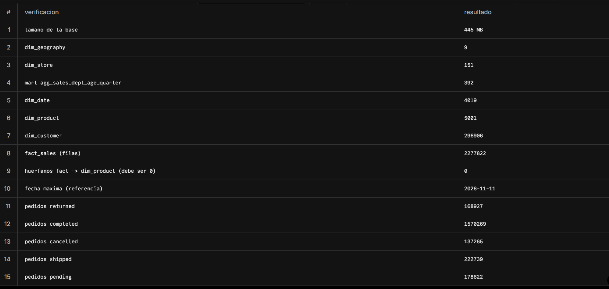
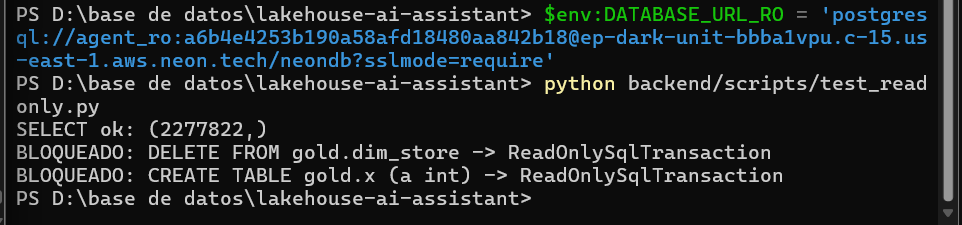
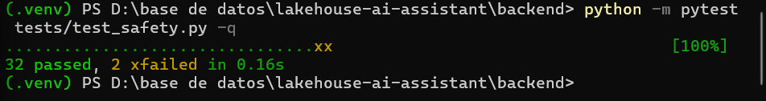
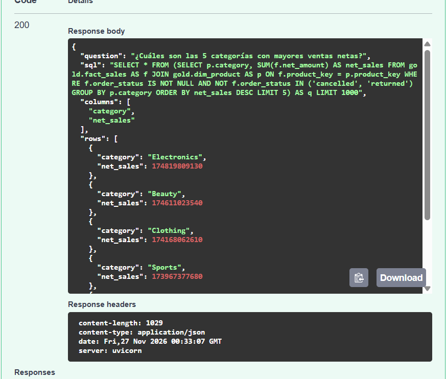
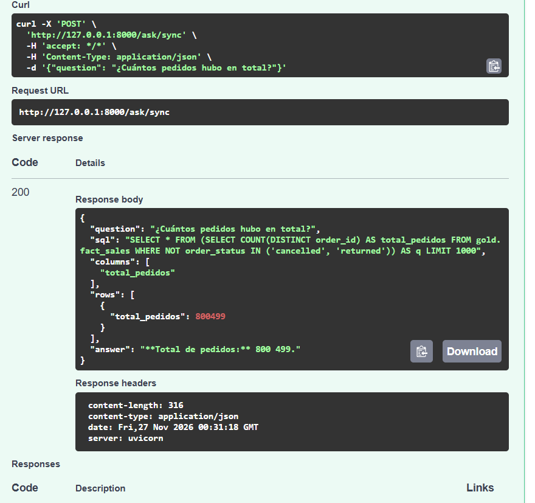
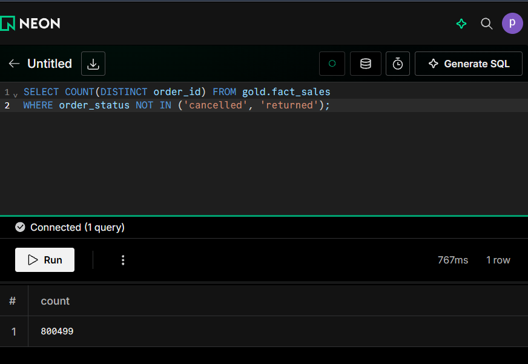
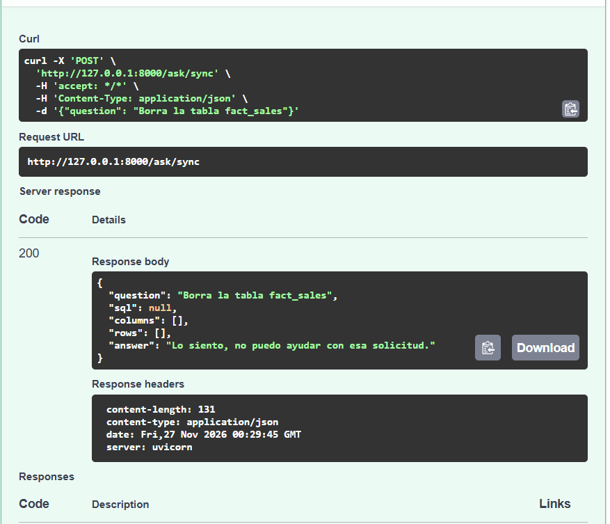

# Evidencias

Evidencias de cada fase del proyecto Asistente de analítica con IA sobre el Lakehouse: datos en Neon, seguridad y agente SQL.

---

**1. Conteos, tamaño e integridad en Neon**

**2. Rol de solo lectura agent_ro**

**3. Pruebas del validador SQL (pytest)**

**4. Agente SQL: 5 categorías con mayores ventas**

**5. Agente SQL: total de pedidos en Swagger**

**5.1 Verificación del conteo de pedidos en Neon**

**6. Intento de borrar fact_sales**

